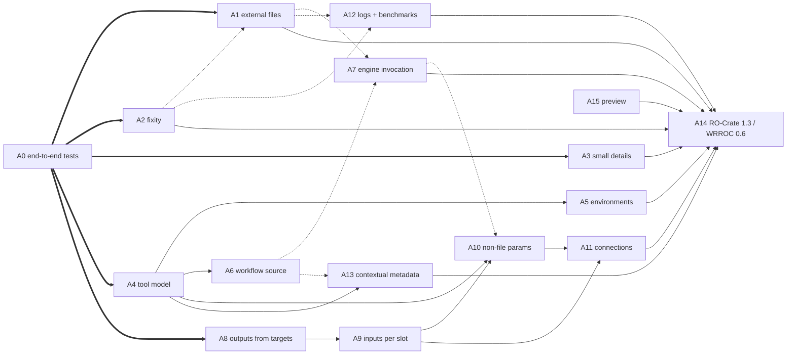

# TODO: RO-Crate completeness of generated crates

Findings from running the plugin (Snakemake 9.27.1, `roc-validator` 0.11.4) on a
small test workflow and inspecting the crate with `rocrate-validator -l OPTIONAL`
and `runcrate report`. The generated crate passes all REQUIRED checks of
`provenance-run-crate-0.5`, but is incomplete or inaccurate in the ways below.

- [Part A](#part-a-plugin-issues-in-pull-request-order) lists plugin issues in
  the order they should be addressed, one pull request each.
- [Part B](#part-b-issues-that-may-need-changes-or-clarification-in-the-profiles)
  lists issues that may need changes to the Workflow Run Crate profiles.

Test workflow used (reproduces every item below):

```python
configfile: "config.yaml"            # samples: [a, b], mode: fast
include: "rules/extra.smk"           # rule extra: ../ext/extra.txt -> results/extra.txt

rule all:
    input: "results/summary.txt", "results/plot.json", "results/extra.txt"

rule count:                          # shell + log + params + wildcards
    input: reads="data/{s}.txt"
    output: "results/{s}.count"
    params: mode=config["mode"]
    log: "logs/count_{s}.log"
    shell: "wc -l {input.reads} > {output} 2> {log}"

rule merge:                          # script:
    input: expand("results/{s}.count", s=config["samples"])
    output: "results/summary.txt"
    script: "scripts/merge.py"

rule plot:                           # conda: + benchmark:
    input: summary="results/summary.txt", ref="data/ref.json"
    output: "results/plot.json"
    conda: "envs/jq.yaml"
    benchmark: "bench/plot.tsv"
    shell: "jq -n --arg s \"$(cat {input.summary})\" '{{summary:$s}}' > {output}"
```

Run `snakemake --cores 1 --sdm conda`, then the same command again with
`--reporter rocrate`, once with `--report-rocrate-metadata-only` and once
without.

Reference documents:

- RO-Crate 1.1: <https://www.researchobject.org/ro-crate/specification/1.1/>
  (current: [1.3](https://www.researchobject.org/ro-crate/specification/1.3/))
- Process Run Crate 0.5: <https://www.researchobject.org/workflow-run-crate/profiles/0.5/process_run_crate/>
- Workflow Run Crate 0.5: <https://www.researchobject.org/workflow-run-crate/profiles/0.5/workflow_run_crate/>
- Provenance Run Crate 0.5: <https://www.researchobject.org/workflow-run-crate/profiles/0.5/provenance_run_crate/>
- Workflow RO-Crate 1.0: <https://about.workflowhub.eu/Workflow-RO-Crate/1.0/>

---

## Pull request plan

Each A-section below is intended as one pull request. The plan is built around
three decisions:

- **Stay on RO-Crate 1.1 and Workflow Run Crate 0.5 until the last PR (A14).**
  The `roc-validator` release the plugin pins only has the 0.5 profiles, and
  WorkflowHub needs Workflow RO-Crate 1.0 (built on RO-Crate 1.1). Every
  earlier PR must therefore use only terms available in the RO-Crate 1.1
  context plus the workflow-run context
  (`https://w3id.org/ro/terms/workflow-run/context`, which defines `sha256`,
  `resourceUsage`, `connection`, `ParameterConnection`, `environment` and
  `containerImage`, `ContainerImage`), and schema.org terms such as
  `DigitalDocument`. `buildInstructions` (A5) is not in either context for
  1.1, so it must be added to `@context` as the 0.5 profile describes.
  1.3-only terms such as `localPath` wait for A14.
- **Fix the tool model (A4) before anything that hangs metadata on tools.**
  Scripts (A6), non-file parameters (A10), environments (A5) and rule-tool
  `url`/`version` (A13) all attach to "the rule's tool". Today that is either
  a rule tool or a list of Conda packages, depending on `--main-tool`.
- **Settle the parameter scheme (A8, A9) before adding more parameters (A10)
  and connections between them (A11).** All of these build parameter `@id`s in
  `_add_formal_parameters`, and changing the scheme twice would churn tests
  and output.

| PR | Section | Size | Depends on | Changes existing output? |
|---|---|---|---|---|
| 0 | [A0](#a0-no-end-to-end-tests-of-the-examples) End-to-end tests with the examples | M | none | no (tests only) |
| 1 | [A1](#a1-metadata-only-mode-writes-data-entities-outside-the-crate-root-bug) External / non-included files | M | A2 (soft: content-addressed IDs) | yes (bug fix, new options) |
| 2 | [A2](#a2-file-entities-lack-fixity-and-size) File fixity and size | S | none | adds properties |
| 3 | [A3](#a3-small-profile-details-actionstatus-position-singleton-values) Small profile details | S | none | adds properties |
| 4 | [A4](#a4-tool-model-every-conda-package-becomes-an-instrument) Tool model | M | none | **yes**: changes instruments, `--main-tool` meaning |
| 5 | [A5](#a5-tool-runtime-environment-and-container-images) Runtime environment, containers | M | A4 | yes (`subjectOf` → `buildInstructions`) |
| 6 | [A6](#a6-workflow-source-is-incomplete-include-script-notebook-wrapper) Workflow source files | M | A4 (scripts part) | adds files |
| 7 | [A7](#a7-engine-invocation-config-files-command-line-version) Engine invocation | M | A6 (soft: shared packaging helper) | adds files/properties |
| 8 | [A8](#a8-workflow-outputs-are-inferred-from-the-job-graph-not-from-the-targets) Workflow outputs from targets | S | none | yes (workflow outputs) |
| 9 | [A9](#a9-workflow-input-parameters-are-created-per-file-not-per-slot) Workflow inputs per slot | M | A8; input from B3 | **yes**: parameter `@id`s |
| 10 | [A10](#a10-non-file-parameters-are-not-recorded) Non-file parameters | M | A4, A9; A7 for config | adds entities |
| 11 | [A11](#a11-parameter-connections) Parameter connections | M | A9, A10 | adds entities |
| 12 | [A12](#a12-logs-and-benchmarks-are-not-captured) Logs and benchmarks | M | A2 (soft: checksums on logs) | adds files/properties |
| 13 | [A13](#a13-missing-contextual-metadata) Contextual metadata | M | A4 (rule-tool part), A6 (README helper) | adds properties/options |
| 14 | [A14](#a14-upgrade-to-ro-crate-13-and-workflow-run-crate-06) RO-Crate 1.3 / WRROC 0.6 | L | all of the above; `roc-validator` support | **yes**: versions |
| any (early) | [A15](#a15-no-ro-crate-previewhtml) RO-Crate preview | S | none | adds a file |
| none | [A16](#a16-validator-noise-to-report-upstream) Validator noise | none | none | upstream issues only |

Dependency graph (an arrow means "should be merged before"):



Dotted arrows are soft dependencies: the later PR can go first, but it will
then need to change again.

**Do A0 first.** The end-to-end test, with a golden copy of the generated
metadata, gives every later PR a reviewable diff of how the crate changes.
The thick arrow means A0 should be merged before all other PRs, not only
the ones it points to.

**What can run in parallel:**
- A1, A2, A3, A4 and A8 have no hard dependencies and touch different code
  paths, so they can be worked on at the same time. If A2 lands first, A1 can
  include the content-addressed identifier option straight away; otherwise
  that option follows in a small PR.
- A1's "reference, don't include" mechanism is reused by A7 (excluded config
  files) and A12 (excluded logs), hence the dotted arrows.
- After A4 is merged, A5, A6 and A13 can proceed in parallel.
- A12 can be done at any point.
- A15 (the HTML preview) has no dependencies. Doing it early helps review
  every later PR, since reviewers can see the output change in a browser.

**Release notes:** A4 and A9 change existing output that downstream consumers
may rely on (instrument IDs, parameter IDs). Group them in one minor release
with a changelog entry, and don't spread them across several releases.

---

## Part A: Plugin issues, in pull request order

### A0. No end-to-end tests of the examples

*PR 0. No dependencies. Do this before all other PRs.*

**Observed:**
- The unit tests (`tests/test_rocrate_builder.py`,
  `tests/test_provenance_files.py`) call the builders with mocked jobs and
  DAGs. Nothing runs Snakemake with `--reporter rocrate`.
- The Snakemake-provided end-to-end test class (`TestReportBase` in
  `tests/test_plugin.py`) is skipped with "Currently not working".
- CI runs `pixi run -e dev test`, so none of the `examples/` are ever
  executed. They can silently break, and the crates they produce are never
  validated or reviewed.

**Example requirements:**

| Example | Run workflow | Report only from committed outputs |
|---|---|---|
| `feature-coverage` | seconds; needs only `jq` (from conda-forge) | yes |
| `linear-elastic-plate-with-hole` | FEniCS/DOLFINx Conda env (large) | yes, checked: passes REQUIRED validation in seconds, without Conda |
| `poisson-equation` | gmsh, FEniCS, tectonic Conda envs (large) | yes, checked: passes REQUIRED validation in seconds, without Conda |

The two large examples commit their outputs and `.snakemake/metadata`. The
reporter therefore works on a copy of them without running any job or
creating any environment. Without environments, though, no package
information is recorded, so these runs exercise the workflow structure but
not the tool modelling.

**Suggested fix:**
1. **Full end-to-end test with `feature-coverage`** (marked e.g.
   `@pytest.mark.e2e`):
   - Copy `examples/feature-coverage/` (both `workflow/` and `external/`) to
     `tmp_path`.
   - Run the workflow, then the reporter with `profiles/rocrate` and
     `profiles/rocrate-metadata-only`. Use the Snakemake API, or
     `python -m snakemake` in a subprocess.
   - Unzip the crate and assert:
     - each feature in the example's README table appears;
     - the external input is handled correctly (see A1; `xfail` until A1 is
       fixed);
     - `runcrate report` can read the crate.
   - Compare the metadata, normalised by removing timestamps, versions and
     dates, against a committed golden file
     (`tests/data/feature-coverage.ro-crate-metadata.json`), and add an
     explicit option to update it. Each later PR then shows its effect on
     the crate as a diff of that file.
2. **Two variants for Conda:**
   - Without `--sdm conda` (always run): add `jq` to the pixi `dev`
     environment so the `plot` rule finds it on `PATH`.
   - With `--sdm conda` (a separate CI job, using conda-forge only, e.g.
     with `setup-miniforge`): this is the only variant that tests the
     package and runtime-environment code (A4, A5).
3. **Report-only smoke tests for the two large examples:** copy the
   git-tracked files of each example to `tmp_path`, and run only the
   reporter with its `profiles/rocrate`, without `--sdm conda`. Assert that
   validation passes. This keeps those examples' Snakefiles, profiles and
   committed metadata working, without installing anything.
4. **Fix or remove the skipped `TestReportBase`.** Find out why it is "not
   working", or replace it with the tests above.

**Considerations:**
- Never run the tests in the source tree: Snakemake writes `.snakemake/`,
  and the reporter writes `_EXTERNAL/` into the working directory (see A1).
- Existing unit tests encode current behaviour that later PRs change on
  purpose. For example,
  `test_omitted_main_tool_uses_installed_packages_as_instruments` asserts
  the behaviour that A4 replaces. Update them in those PRs.
- The committed example crates (`examples/*/…-workflow-run.zip`) should be
  regenerated by a script, not by hand, so that they stay consistent with
  the code. That script can share the test's setup.

### A1. Metadata-only mode writes data entities outside the crate root (bug)

*PR 1. No hard dependencies. The content-addressed identifier option uses the
checksum helper from A2.*

**Observed:** With `--report-rocrate-metadata-only`, an input outside the working
directory is recorded as `"@id": "../ext/extra.txt"` and listed in the root's
`hasPart`. `roc-validator` does not detect this.

**Spec:** In RO-Crate 1.1 a [File data entity](https://www.researchobject.org/ro-crate/specification/1.1/data-entities.html#file-data-entity)
`@id` "MUST be either a URI Path relative to the RO Crate root, or an absolute
URI". RO-Crate 1.3 says that a locally packaged file's `@id` "MUST be a URI Path
relative to the RO Crate Root" ([1.3 data entities](https://www.researchobject.org/ro-crate/specification/1.3/data-entities.html#file-data-entity)).
A path starting with `../` points outside the root, so the crate breaks when it is
moved, zipped or published. An absolute-URI `File` is a Web-based data entity,
which "SHOULD at the time of RO-Crate creation be directly downloadable".

**Code:** `provenance_files.py:187` (the `os.path.relpath` fallback in
`_copy_external_relative_files`).

The general problem is how to identify a file that the run used or produced but
that is *not in the crate* and cannot be downloaded. The same need comes up for
large outputs, sensitive data, and logs or config files that are left out on
purpose (A7, A12), so the fix should be a reusable "reference, don't include"
mechanism, not a special case for metadata-only mode.

#### Prior art

- **Five Safes RO-Crate** ([5s-Crate 0.4, Sensitive data](https://trefx.uk/5s-crate/0.4/#sensitive-data)):
  data that is only accessible inside a Trusted Research Environment is typed
  `DigitalDocument` (not `File`), with an `urn:uuid:` identifier, `name` and
  `encodingFormat`. Access restrictions are expressed with
  `hasDigitalDocumentPermission` → `DigitalDocumentPermission`
  (`permissionType` `http://schema.org/ReadPermission`, `grantee` the project).
  Its [security considerations](https://trefx.uk/5s-crate/0.4/#security-considerations)
  recommend UUID v5 hashing, so that identifiers do not reveal the sensitive
  names they are derived from. All of these terms are in the RO-Crate 1.1
  context.
- **COMPSs** ([workflow provenance docs](https://compss-doc.readthedocs.io/en/latest/Sections/04_Ecosystem/05_Workflow_Provenance/01_Run/04_Result.html)):
  with `data_persistence: False` (the default), datasets are not copied. In a
  published example ([WorkflowHub 1047](https://doi.org/10.48546/workflowhub.workflow.1047.1)),
  each external file is a `File` with `@id`
  `file://<hostname>/<absolute path>`, `name` (basename), `contentSize`,
  `dateModified` and `sdDatePublished`. These entities are listed in the
  root's `hasPart` and used as `object`/`result` of the `CreateAction`. Size
  and modification date stand in for a file version. Downsides: the
  identifiers expose the HPC node name, the username and the home directory
  layout. The `file://` URI resolves only on that host, yet the entity is
  typed and listed as a downloadable data entity.
- **arcp URI scheme** ([draft-soilandreyes-arcp](https://datatracker.ietf.org/doc/draft-soilandreyes-arcp/),
  [library docs](https://arcp.readthedocs.io/)), also used by RO-Crate for
  [absolute identifiers of non-web crates](https://www.researchobject.org/ro-crate/specification/1.1/appendix/relative-uris.html):
  - `arcp://uuid,<uuid>/<path>`: a random or UUID v5 "archive" identifier
    plus a path inside it. This keeps the directory structure of a group of
    external files without revealing where they live.
  - `arcp://ni,sha-256;<base64url digest>/`: content-addressed, so it
    identifies the exact bytes that were used. This also helps with B2.
  - `arcp://name,<name>/<path>`: a name-based identifier, which leaks names
    like `file://` does.

#### Suggested fix (RO-Crate 1.1 compatible)

1. **If the file has a real URL, use it.** Inputs from Snakemake storage
   plugins (`s3://`, `https://`, `gs://`, …) already have a query URI.
   Record them as Web-based `File` data entities with that `@id`, and add
   `contentUrl` if the download URL differs.
2. **Otherwise, reference the file without claiming it is downloadable.**
   Type it `DigitalDocument`, not `File`, and do not list it in the root's
   `hasPart`. It is still reachable as an action's `object`/`result`, which
   the profiles allow for any entity. Record:
   - `name`: the basename
   - `encodingFormat`, `contentSize`, `dateModified`
   - `sha256`, once A2 is in place
   - `sdDatePublished`, as COMPSs does, if useful
3. **Choose the identifier with a plugin option**, e.g.
   `--report-rocrate-external-id {uuid,content,file}`:
   - `uuid` (default): `urn:uuid:` UUID v5 of the absolute path (and
     hostname), so it is stable across reports of the same run without
     revealing the path. Alternatively, use `arcp://uuid,<uuid v5 of the
     external directory>/<relative path>`, which keeps the structure of
     related files visible.
   - `content`: `arcp://ni,sha-256;…/`, identifying exactly the bytes used.
     Two different paths with the same content collapse into one entity,
     which is correct for provenance but surprising for readers, so set
     `name` from the path. Needs the A2 hashing helper.
   - `file`: `file://<hostname>/<absolute path>`, as COMPSs does. This is
     informative on a shared cluster, but exposes host, user and directory
     names, so make it opt-in only.
4. **Apply the same choice in ZIP mode.** Today, external files are always
   copied into `_EXTERNAL/`. Add `--report-rocrate-external-files {copy,reference}`
   so large or sensitive external inputs can be referenced rather than
   packaged. Metadata-only mode always uses `reference`.
5. **Optional, access restrictions:** when the user marks paths as
   restricted, add `hasDigitalDocumentPermission` as 5s-Crate does. This is
   probably a follow-up PR rather than part of A1.

**Considerations:**
- Check that `runcrate report` and `roc-validator` accept a `DigitalDocument`
  as an action's `object`/`result`, and that `exampleOfWork` links to its
  `FormalParameter` still work. Neither profile requires `File` there, but
  tools may assume it. If they fail, report that upstream rather than going
  back to `File`.
- A UUID v5 needs a namespace. Use a fixed namespace UUID per plugin, or one
  derived from the run (e.g. the workflow-run `CreateAction`), and document
  the choice. A per-run namespace stops identifiers from being correlated
  across crates.
- Add a unit test, and a check in `validator.py`, asserting that no data
  entity `@id` starts with `../` or `/`.
- ZIP mode copies external files into an `_EXTERNAL/` folder in the working
  directory (`provenance.py:96-127`). It first runs `shutil.rmtree` on any
  existing `_EXTERNAL/` there, and deletes it again at the end, so a
  workflow's own `_EXTERNAL/` folder would be deleted without warning. Build
  the staging tree in a temporary directory instead.
- The copied file's original location is not recorded in the crate. The
  plugin keeps it internally (the `"source path"` of the file node,
  `provenance_files.py:83`) only to know what to copy. The `File` entity
  `_EXTERNAL/ext/extra.txt` has just `@id`, `name` (the same `_EXTERNAL/…`
  path), `encodingFormat` and `exampleOfWork`. Meanwhile, the packaged
  Snakefile and the recorded shell command still use the original path
  (`../ext/extra.txt`), and nothing links the two.
- RO-Crate 1.3 has `localPath` for exactly this kind of link
  ([1.3 data entities](https://www.researchobject.org/ro-crate/specification/1.3/data-entities.html#core-metadata-for-data-entities)).
  A `File` with a `#` identifier "SHOULD" use `localPath` "to indicate that a
  File could be found at that path in some circumstances", and Web-based
  entities MAY use it for the path to download them to. `localPath` is in the
  1.3 context, but not in the 1.1 context.
  - **Now, on 1.1:** record the original path as the workflow refers to it
    (`../ext/extra.txt`, relative to the working directory) in `description`,
    or with an explicitly mapped term.
  - **On 1.3 (A14):** use `localPath`. For a file copied to `_EXTERNAL/`,
    `localPath: "../ext/extra.txt"` would also tell someone re-running the
    workflow where to put the file. However, the spec only defines
    `localPath` for `#` files and Web-based entities, not for files inside an
    attached crate, and the value points outside the crate root. This is
    worth raising with the RO-Crate community (see B6).
  - Only record paths relative to the working directory, never absolute
    ones. The folder structure under `_EXTERNAL/` already mirrors the path
    below the common ancestor directory, which can include usernames, e.g.
    `/home/<user>/…`.
- RO-Crate 1.3 adds `File` entities with `#` identifiers and `localPath` for
  files "deliberately not present". When upgrading (A14), consider that form
  for the `file` option, since it records the path without implying that the
  file can be downloaded.
- The general question of how to reference non-included and non-downloadable
  files may be worth raising with the RO-Crate community, so that 5s-Crate,
  COMPSs and this plugin converge (see B6).

### A2. File entities lack fixity and size

*PR 2. No dependencies.*

**Observed:** Files have only `name`, `encodingFormat` and `exampleOfWork`.

**Suggested fix:** Add `contentSize`, `dateModified` (from the file's mtime) and
`sha256`. `sha256` is defined in the workflow-run context the crate already
loads, so this works with RO-Crate 1.1. Checksums let consumers detect whether
a file changed after the run (see B2). Set `encodingFormat` to more specific
types where known. Snakefiles currently get `text/plain`; `text/x-snakemake`
or the language entity could be used instead.

**Considerations:**
- Hashing large outputs costs time. Use streaming reads, and consider an
  option to skip hashing above a size limit.
- Put the hashing in a helper that A6, A7 and A12 can reuse for the files they
  add.

### A3. Small profile details: actionStatus, position, singleton values

*PR 3. No dependencies.*

These are OPTIONAL or RECOMMENDED in the profiles and cheap to add, using
information the plugin already has:

- `actionStatus` (`http://schema.org/CompletedActionStatus`) on `ControlAction`s
  and `CreateAction`s. Snakemake only reports successful jobs, so this is always
  "completed" ([Provenance Run Crate requirements](https://www.researchobject.org/workflow-run-crate/profiles/0.5/provenance_run_crate/#requirements)).
- `position` on each `HowToStep`, from a topological order of the rule graph.
  The profile only requires that a step which needs another step's outputs has
  a higher position. The ordering is already computed in
  `_add_precedes_relations` (`provenance_graph.py:25`), but the builder never
  writes it out.
- `startTime`/`endTime` on `ControlAction`s, copied from their `CreateAction`.
- Singleton arrays: `_compact_single_value_properties`
  (`rocrate_builder.py:277`) only compacts `result`/`output`, so `object`/`input`
  still trigger "SHOULD be represented as a single value" warnings
  ([1.1 JSON-LD appendix](https://www.researchobject.org/ro-crate/specification/1.1/appendix/jsonld.html)).
  Apply it to every property.

### A4. Tool model: every Conda package becomes an instrument

*PR 4. No dependencies. A5, A6, A10 and A13 build on it. Changes existing
output.*

**Observed:** When `--report-rocrate-main-tool` is not given, the `plot` action
has six instruments: `jq` plus `_openmp_mutex`, `libgcc`, `libgcc-ng`, `libgomp`
and `oniguruma`. Each of these gets the rule's `input`/`output` FormalParameters
(so `libgcc` "takes" `summary`), and all of them appear in the `HowToStep`'s
`workExample` and the workflow's `hasPart`. Rules without Conda get a rule-tool
entity instead, so the two kinds of rule are modelled differently.

**Code:** `rocrate_builder.py:403` (`if not preferred_package and package_ids:`).

**Spec:** The profiles separate four concerns:

| Concern | Where it is defined | Property | Attached to |
|---|---|---|---|
| The tool that ran | [Process Run Crate requirements](https://www.researchobject.org/workflow-run-crate/profiles/0.5/process_run_crate/#requirements) | `instrument` | `CreateAction` |
| Named software it needs | [Process Run Crate: Specifying software dependencies](https://www.researchobject.org/workflow-run-crate/profiles/0.5/process_run_crate/#specifying-software-dependencies); [Provenance Run Crate: Tool wrapper dependencies](https://www.researchobject.org/workflow-run-crate/profiles/0.5/provenance_run_crate/#tool-wrapper-dependencies) | `softwareRequirements`, `mainEntity` | the tool |
| How to build its runtime environment | [Provenance Run Crate: Tool runtime environment](https://www.researchobject.org/workflow-run-crate/profiles/0.5/provenance_run_crate/#tool-runtime-environment) | `buildInstructions` | `HowToStep` / `HowTo` |
| Which container image was used | [Process Run Crate: Representing container images](https://www.researchobject.org/workflow-run-crate/profiles/0.5/process_run_crate/#representing-container-images) | `containerImage` | `CreateAction` |

The Provenance Run Crate builds on the Process Run Crate, so all of these
apply. A4 handles the first two rows; A5 handles the last two.

The current code puts the whole resolved Conda environment into the first or
second row. The profile instead uses `softwareRequirements` to name the
software a tool needs installed in order to run: the programs its command
calls (`jq`, `blast`) and, for a script, the libraries the script uses (the
profile's example lists NumPy for a Python script). Low-level libraries that
almost every compiled program links against, such as the C runtime
(`libgcc`) or OpenMP (`libgomp`), say nothing about what the rule does. They
belong in the runtime environment, which the profile describes as "a more
reproducible definition of a tool's runtime environment" in an environment
file referenced by `buildInstructions` (A5).

**Suggested fix:**
- Always create the rule tool (`#rule-tool-…`) as the single `instrument` of
  each job's `CreateAction`, and as the `workExample` of its `HowToStep`.
- List in its `softwareRequirements` the packages *declared* in the rule's
  environment YAML, with the version that was actually installed (from
  `conda-meta`). The YAML is where the workflow author names the software the
  rule needs, e.g. `jq` 1.7.1 for `plot`, or `blast` for a search rule.
  Packages that Conda only installed to satisfy those (here `oniguruma`,
  `libgcc`, `_openmp_mutex`) are not listed. They are recorded in the
  resolved environment file (A5).
- Use `mainEntity` for the wrapped tool, as in
  [Tool wrapper dependencies](https://www.researchobject.org/workflow-run-crate/profiles/0.5/provenance_run_crate/#tool-wrapper-dependencies):
  the script for `script:` rules (A6), or the package chosen with
  `--main-tool`. `--main-tool` then only selects `mainEntity`, rather than
  switching between two models.
- For `envmodules:`, list the module names and versions in
  `softwareRequirements`. There is no environment file to reference.

**Considerations:**
- Package identifiers: the profile examples use the registry's
  version-specific URL as the `@id` (`https://pypi.org/project/numpy/1.26.2/`).
  For Conda, the package URL recorded in `conda-meta`
  (`https://conda.anaconda.org/conda-forge/linux-64/jq-1.7.1-hd590300_0.conda`)
  is absolute and version-specific. It also satisfies the RECOMMENDED
  "SoftwareApplication id SHOULD be an absolute URI". Use
  `https://anaconda.org/<channel>/<name>` as `url`. The current fallback,
  `https://anaconda.org/search?q=…`, is a search page and should go.
- Version property: the 0.5 examples use `version`, while 0.6 uses
  `softwareVersion` and says not to give both. `roc-validator` 0.11.4 accepts
  either. Keep `softwareVersion` for packages, and revisit in A14.
- A YAML may also declare things that are not really the rule's software,
  such as `python` or `pip`, or a package only pinned to fix a solver
  problem. List them anyway: the plugin cannot tell the difference, and the
  author chose to declare them. `--main-tool`/`mainEntity` is how to say which
  one matters.
- Python code in the workflow also has software requirements, and these are
  often not declared in any environment file:
  - `run:` blocks are inline Python executed inside the Snakemake process
    itself, so the packages they use come from the environment Snakemake is
    installed in. A `conda:` directive on a `run:` rule is accepted (checked
    with Snakemake 9.27.1), but only applies to `shell()` calls made inside
    the block, not to the Python code.
  - Top-level code and imports in the Snakefile (and included files) run in
    the same process, and `run:` blocks can use those imports.
  - `script:` rules without `conda:` run in whatever Python environment is
    active, typically Snakemake's own.

  For these rules, find the imported top-level modules by parsing the code
  with `ast` (the `run:` block's source, the Snakefile's top-level imports,
  and the script). Map modules to distributions with
  `importlib.metadata.packages_distributions()`, and record each
  distribution's name and installed version in the rule tool's
  `softwareRequirements`. Use PyPI release URLs as `@id`
  (`https://pypi.org/project/pandas/2.2.3/`), as in the profile's NumPy
  example. Skip standard-library modules (`sys.stdlib_module_names`).
- Caveat for the Python packages above: they are read at report time from the
  environment running the reporter, which may differ from the environment the
  jobs ran in. This is the same limitation as the Snakemake version (A7).
  Say so in the README, and consider recording the reporter environment's
  Python version as well.
- Shell-only rules without `conda:` (or `envmodules:`) have no declared
  packages. Their `softwareRequirements` stays empty rather than being
  guessed from the shell command.
- Update the README sections on `main-tool` and on how tools are modelled.

### A5. Tool runtime environment and container images

*PR 5. Depends on A4. Changes existing output (`subjectOf` → `buildInstructions`).
Could be split into a Conda PR and a container PR.*

**Observed:**
- The rule tool links its environment YAML with `subjectOf`
  (`rocrate_builder.py:423`), and nothing links it when no main tool is set.
- The resolved environment (all installed packages) is only represented as a
  list of tool entities (A4).
- `container:`/`containerized:` directives and `--sdm apptainer` are not
  recorded at all.

**Spec:**
- [Provenance Run Crate: Tool runtime environment](https://www.researchobject.org/workflow-run-crate/profiles/0.5/provenance_run_crate/#tool-runtime-environment):
  "environment files are indicated as `buildInstructions` for either the
  `HowToStep` (for a given step) or the `HowTo` (for the whole workflow)". Its
  example types a Conda YAML as `File` with `encodingFormat`
  `application/yaml` and `conformsTo` the Conda environment-file
  documentation (a `WebPageElement`). It says `encodingFormat` and/or
  `conformsTo` SHOULD be given for machine-readable environment files.
- In 0.5 on RO-Crate 1.1, `buildInstructions` (a CodeMeta term) is in neither
  the RO-Crate 1.1 context nor the workflow-run context. The 0.5 profile says
  to add `{"buildInstructions": "https://codemeta.github.io/terms/buildInstructions"}`
  to the `@context`. RO-Crate 1.2+ contexts include it.
- [Process Run Crate: Representing container images](https://www.researchobject.org/workflow-run-crate/profiles/0.5/process_run_crate/#representing-container-images):
  `containerImage` on the `CreateAction`, pointing to a `ContainerImage`
  entity. This SHOULD have at least `additionalType` (`DockerImage` or
  `SIFImage` from the workflow-run namespace), `registry` and `name`, and MAY
  have `tag` and `sha256`. Alternatively, `containerImage` can be a plain URL
  string. All of these terms are in the workflow-run context.
- The profile notes that "runtime environment" means software, not
  environment variables. Do not use the workflow-run `environment` property
  for this: it is for environment variable settings.

**Suggested fixes:**
1. **Conda environment files:**
   - Package each rule's environment YAML and set it as `buildInstructions` of
     that rule's `HowToStep`. A global `conda:` directive goes on the workflow
     (`HowTo`).
   - Type the YAML `File` with `encodingFormat` `application/yaml` and
     `conformsTo` the Conda environment-file page, exactly as in the profile
     example.
   - Add the `buildInstructions` term mapping to the crate's `@context`
     (`self.crate.metadata.extra_contexts`, next to `WORKFLOW_RUN_CONTEXT`).
   - Remove `subjectOf` from the rule tool.
2. **Pinned and resolved environments:**
   - If Snakemake's pin file (`<env>.<platform>.pin.txt`, next to the YAML)
     exists, package it as a second `buildInstructions` entry. Give it its own
     `conformsTo`, pointing to the Conda explicit-specification format.
   - Otherwise, generate an equivalent explicit specification from the job's
     `conda-meta` records (each package's URL and MD5) and package that
     instead. This is where the packages Conda installed only as dependencies
     (which A4 leaves out of `softwareRequirements`) are recorded, in a form
     that `conda create --file` can re-instantiate.
   - Name the generated file after the environment hash Snakemake uses, so that
     rules that share an environment share the file.
3. **Container images:**
   - For jobs run with a `container:` image (per rule or global), add
     `containerImage` on the job's `CreateAction`. Point it to a
     `ContainerImage` entity with:
     - `additionalType`: `DockerImage` for `docker://` images, `SIFImage` for
       local `.sif` files
     - `registry` and `name`
     - `tag`
     - `sha256`: from the image digest if pinned (`@sha256:`), or computed
       from the cached `.sif` in `.snakemake/singularity/`
   - For `containerized:` (a single image containing all the Conda
     environments), use the same image for every job, and still record the
     Conda `buildInstructions` per step.
   - Use a stable `@id` per image (e.g. `#container-<sha256>`, or the
     registry reference), so that jobs share the entity.

**Considerations:**
- The profile defines `buildInstructions` only on the prospective side
  (`HowToStep`/`HowTo`): it describes how the environment *should* be built,
  not what was actually installed for a particular job. The resolved
  environment from step 2 is retrospective information that has no defined
  place on the `CreateAction`. See B7.
- An image used by `--sdm apptainer` may have been pulled long before the run,
  and the tag may now point to a different image. Prefer the digest of the
  cached image actually used.
- Check that `runcrate` still handles the crate, since it may only read
  `instrument`.

### A6. Workflow source is incomplete: include, script, notebook, wrapper

*PR 6. The `script:`/`notebook:` part depends on A4. The module part could be
split out as a separate PR with no dependencies.*

**Observed:** These are missing from the crate:
- `include:` files (`rules/extra.smk`)
- `script:` files (`scripts/merge.py`)
- `notebook:` files and `wrapper:` sources (not tested, but there is no code
  path for them)

Scripts are found only by heuristically parsing shell commands for an
interpreter (`provenance_files.py:98`), so `script:` rules get the action
description "Execute rule merge" (`provenance.py:153`).

**Spec:** [Workflow RO-Crate 1.0](https://about.workflowhub.eu/Workflow-RO-Crate/1.0/)
expects the crate to contain the workflow so that it can be re-run.

**Suggested fixes:**
- Package every Snakefile module from Snakemake's workflow object (e.g.
  `workflow.included`/the source cache), and list them in the main workflow's
  `hasPart`. Type them `["File", "SoftwareSourceCode"]` with
  `programmingLanguage` Snakemake.
- For `script:`/`notebook:` rules, take the path from the rule object
  (`rule.script`, `rule.notebook`), not from the shell command. Package the
  file as `["File", "SoftwareSourceCode"]` with its `programmingLanguage`.
  Link it from the rule tool introduced in A4 through `mainEntity` or
  `hasPart` (see
  [Tool wrapper dependencies](https://www.researchobject.org/workflow-run-crate/profiles/0.5/provenance_run_crate/#tool-wrapper-dependencies)).
  Use "Run script scripts/merge.py" as the action description.
- For `wrapper:`, record the wrapper URL/version as a `SoftwareApplication`
  linked from the rule tool.

**Considerations:**
- Some `include:`/`module:` sources are remote (GitHub, `github()` objects).
  Use web-based data entities for those rather than copying them.
- Factor out a "package a workflow source file" helper, which A7 and A13 can
  reuse.

### A7. Engine invocation: config files, command line, version

*PR 7. Soft dependency on A6 (shared packaging helper).*

**Observed:**
- The `configfile:` (`config.yaml`), any `--configfile`, and the `--profile`
  config files are not in the crate.
- The Snakemake command line and targets are not recorded.
- `#snakemake` and the language entity carry the version of Snakemake that
  generated the report, not necessarily the one that ran the jobs (documented
  in the README).

**Spec:** [Engine configuration files](https://www.researchobject.org/workflow-run-crate/profiles/0.5/provenance_run_crate/#engine-configuration-files):
the config file "SHOULD be added to the `object` attribute of the
corresponding `OrganizeAction`".

**Suggested fixes:**
- Package the config files and add them to the `OrganizeAction`'s `object`.
- Record the report-generation command (`sys.argv`) and the targets as the
  `OrganizeAction`'s `description`. Make clear that this is the report command,
  which may differ from the command that ran the jobs (see B1).
- Use the header of Snakemake's own run logs (`.snakemake/log/*.snakemake.log`).
  In Snakemake 9 this records, for each invocation, the workflow ID, the
  Snakemake and Python versions, the full command, the config files and the
  config MD5. This gives the run-time Snakemake version rather than the
  report-time one, and the real invocation command. Match logs to jobs by
  time. The same logs can drive the per-invocation grouping proposed in B1.
- Raise upstream with Snakemake that `.snakemake/metadata` should record the
  workflow ID or Snakemake version per job, so this does not depend on log
  files that may have been deleted.

**Considerations:** Config files may contain secrets or local paths. Add an
option to exclude them, and reference excluded files with the A1 mechanism.

### A8. Workflow outputs are inferred from the job graph, not from the targets

*PR 8. No dependencies. A9 builds on it.*

**Observed:** Only files that are produced and never consumed become workflow
outputs (`rocrate_builder.py:508-519`). `results/summary.txt`, a target of
`rule all`, is not a workflow output, because `plot` consumes it.

**Suggested fix:** Use the requested targets (the inputs of the default target
rule, or the CLI targets, e.g. `dag.targetfiles`) as the workflow outputs, and
fall back to the current heuristic when they are unavailable.

**Considerations:** Do this in the same code that A9 reworks for inputs, and
introduce a small "workflow interface" helper there that A9 can extend.

### A9. Workflow input parameters are created per file, not per slot

*PR 9. Depends on A8. Changes parameter `@id`s. Raise B3 with the community
first, or in parallel.*

**Observed:** The two samples gave workflow parameters `reads` and `reads_2`
(`rocrate_builder.py:521-534`). With 1,000 samples there would be 1,000
`FormalParameter`s, and the names depend on the order of the files.

**Suggested fix:** Create one workflow-level `FormalParameter` per rule input
slot, e.g. `count.reads`, and attach all matching files to it through
`exampleOfWork`. The profiles do not define a "multiple values" flag for
`FormalParameter`; schema.org's `multipleValues` is a candidate, but needs
agreement (see B3). Alternatively, model each slot's files as a single
`Collection` value (see
[multi-file objects](https://www.researchobject.org/workflow-run-crate/profiles/0.5/process_run_crate/#representing-multi-file-objects)).

**Considerations:**
- Snakemake has no declared workflow interface, which is why this is
  heuristic. See also B3.
- Fix the parameter `@id` scheme here, since A10 and A11 build on it.

### A10. Non-file parameters are not recorded

*PR 10. Depends on A4 (parameters attach to the rule tool) and A9 (parameter
`@id` scheme). The config part depends on A7.*

**Observed:** Only files appear as `object`/`result`. `params: mode=fast`, the
config values, wildcards (`s=a`), `threads` and `resources` are absent.

**Spec:** The [Workflow Run Crate](https://www.researchobject.org/workflow-run-crate/profiles/0.5/workflow_run_crate/)
and the [Process Run Crate](https://www.researchobject.org/workflow-run-crate/profiles/0.5/process_run_crate/)
represent non-file values as `PropertyValue` entities in `object`, linked to
their `FormalParameter` through `exampleOfWork`. The plugin already has the
`PropertyValue` code path (`_link_action_value_to_parameter`), but nothing
feeds it.

**Suggested fixes:**
- For each job, add one `PropertyValue` per `params` entry, wildcard and
  (optionally) `threads`/`resources` entry. Link each to a tool-level
  `FormalParameter`, e.g. `#parameter/tool/count/params/named/mode`.
- At workflow level, flatten the effective `config` into `PropertyValue`s for
  the workflow `CreateAction`. If that is too much, rely on the config file
  packaged in A7.
- Use `additionalType` `Text`/`Integer`/`Float`/`Boolean`/`Collection` as in the
  profile examples.

**Considerations:** Params can be callables or large objects, so serialise
conservatively (`str()`, with a length cap). Config may contain secrets: reuse
A7's exclude option.

### A11. Parameter connections

*PR 11. Depends on A9 and A10, so that every parameter it connects exists.*

**Observed:** There is no `connection` / `ParameterConnection`, so the data
flow between rules is only implicit, through shared files.

**Spec:** [Representing parameter connections](https://www.researchobject.org/workflow-run-crate/profiles/0.5/provenance_run_crate/#representing-parameter-connections)
(MAY). Connections to workflow output parameters are referenced from the
workflow; other connections are referenced from the receiving step.

**Suggested fix:** Derive connections from the same shared-file analysis as
`_add_precedes_relations`, with an output parameter of rule X as
`sourceParameter` and the input parameter of rule Y that consumes the same file
as `targetParameter`. Add workflow input → tool input and tool output →
workflow output connections from the A8/A9 interface.

### A12. Logs and benchmarks are not captured

*PR 12. Soft dependency on A2 (checksums for the added files). Otherwise
independent, so it can be done at any point.*

**Observed:** `log:` (`logs/count_*.log`) and `benchmark:` (`bench/plot.tsv`)
files are not in the crate.

**Suggested fixes:**
- Add log files to the crate and to the job `CreateAction`'s `result`, or link
  them through `subjectOf`, so they are not confused with data outputs. The
  same could be done for the main Snakemake log
  (`.snakemake/log/*.snakemake.log`) on the `OrganizeAction`.
- Parse the benchmark TSV into
  [`resourceUsage`](https://www.researchobject.org/workflow-run-crate/profiles/0.5/provenance_run_crate/#representing-resource-usage)
  `PropertyValue`s with `propertyID` and `unitCode` (e.g. `s`, `max_rss` in MB)
  on the job `CreateAction`.

**Considerations:** Logs can be large or contain paths and usernames, so make
including them optional, and reference excluded logs with the A1 mechanism.

### A13. Missing contextual metadata

*PR 13. The rule-tool part depends on A4. Soft dependency on A6 (README
packaging helper). Could be split into a "workflow metadata options" PR and a
"rule tool URL/version" PR.*

These cause the remaining RECOMMENDED validator findings:

- `CreateAction`s have no `agent` unless `agent-*` is set. Root `author` is
  missing unless `researcher-*` is set, and `publisher` falls back to a Person,
  although the validator wants an Organization (`rocrate_builder.py:135-186`).
  Suggestion: when `researcher-*` is given and `agent-*` is not, use the
  researcher as the agent. Document that these options are needed for
  RECOMMENDED compliance. Do not fall back to a Person as publisher.
- The workflow (`Snakefile`) lacks `version`, `license`, `author`/`creator` and
  `url`. Suggestion: add plugin options (`workflow-version`, `workflow-url`,
  `workflow-license`), or read them from a git checkout (commit SHA as
  `version`, remote URL as `url`), without making them up.
- Rule tools (`#rule-tool-*`) lack `url` and `version`. They could point back
  into the workflow (`url` = workflow URL plus a rule anchor), or carry the
  workflow version. See B5.
- No `README.md`. Package the workflow's README when one exists next to the
  Snakefile. `_add_supplemental_files` already handles `about` and
  `encodingFormat` for it, but nothing adds the file.
- The workflow-run `CreateAction` reuses the crate `description` and has the
  generic `name` "workflow run". Give it a description of its own, e.g. the
  targets that were built.

### A14. Upgrade to RO-Crate 1.3 and Workflow Run Crate 0.6

*PR 14. Do this last: it touches the output of every earlier PR. Blocked on a
`roc-validator` release with the 0.6 profiles.*

**Observed:** The crate declares RO-Crate 1.1 (`rocrate_builder.py:55`) and
Workflow Run Crate 0.5, and validation is pinned to `provenance-run-crate-0.5`
(`validator.py:29`, `roc-validator==0.11.4`). The current versions are
[RO-Crate 1.3](https://www.researchobject.org/ro-crate/specification/1.3/) and
[Provenance Run Crate 0.6](https://w3id.org/ro/wfrun/provenance/0.6).

**Suggested fix:** Add an option to choose the output version, with 1.1/0.5
kept for WorkflowHub compatibility and 1.3/0.6 as the future default.

When upgrading, revisit:
- A1: consider `File` with a `#` identifier and `localPath` for the `file`
  identifier option.
- A2: `sha256` becomes part of the RO-Crate 1.2+ context.
- A4: switch package versions to `softwareVersion` only, as 0.6 prefers.
- A5: drop the explicit `buildInstructions` context mapping, which the 1.2+
  context includes.
- Profile entities need `Profile` in `@type` (already done).

**Considerations:**
- Workflow RO-Crate 1.0 is defined on RO-Crate 1.1, and the validator's
  `workflow-ro-crate-1.0` rules fail on 1.3 crates because of version
  mismatches, not real errors. Keep 1.1 as long as WorkflowHub deposit is a
  main use case.
- Also consider naming the ZIP `*.crate.zip`, as WorkflowHub expects.

### A15. No ro-crate-preview.html

*Any time; suggested early. No dependencies.*

**Observed:** Neither the ZIP nor the metadata-only output contains an HTML
preview, so a human opening the crate (or a WorkflowHub or Zenodo landing
page that shows the archive's files) sees only JSON-LD.

**Spec:** [RO-Crate 1.1: RO-Crate Website](https://www.researchobject.org/ro-crate/specification/1.1/structure.html#ro-crate-website-ro-crate-previewhtml-and-ro-crate-preview_files)
says the crate MAY include `ro-crate-preview.html`. If present, it MUST:
- be valid HTML 5
- be useful to users of the crate
- contain a copy of the RO-Crate JSON-LD in a
  `<script type="application/ld+json">` element in the `<head>`

It SHOULD display at least the root data entity's metadata as static HTML,
without the need for scripting. Extra resources go in
`ro-crate-preview_files/`.

**Options checked:**
- **ro-crate-py built-in preview** (`ROCrate(..., gen_preview=True)`, version
  0.16.0, already a dependency): renders the root and the data entities with
  a Jinja template, and adds a `CreativeWork` entity for
  `ro-crate-preview.html` that is `about` the root. However, it does **not**
  embed the JSON-LD in the page, which the 1.1 MUST requires. It also doesn't
  show actions, tools or parameters.
- **`rochtml`** (npm [`ro-crate-html`](https://www.npmjs.com/package/ro-crate-html)
  0.1.6, used for the examples): embeds the JSON-LD, statically renders the
  root and every entity with links between them, and loads optional dynamic
  features from unpkg.com. It is a Node.js tool, so it is not a reasonable
  runtime dependency for a Python reporter plugin.

**Suggested fix:**
- Generate the preview in the plugin from its own Jinja template (Jinja2 is
  already installed as a dependency of `rocrate`):
  - embed the JSON-LD in `<head>`;
  - render the root metadata statically;
  - add a run summary: a table of the job `CreateAction`s with rule, start
    and end time, inputs, outputs and tool, plus the workflow's inputs and
    outputs.
- Alternatively, use ro-crate-py's `gen_preview=True` and inject the JSON-LD
  script element after writing. Report the missing JSON-LD upstream to
  <https://github.com/ResearchObject/ro-crate-py/issues> either way.
- Add `--report-rocrate-preview` (default on). In metadata-only mode, write
  `ro-crate-preview.html` next to `ro-crate-metadata.json`.
- Do not list the preview in the root's `hasPart`, as it is not payload.

**Considerations:**
- The page must not fetch external scripts by default: it may be opened
  offline, or inside a Trusted Research Environment. Keep everything
  inline, or under `ro-crate-preview_files/`.
- Escape all values (rule source, shell commands, file names) when rendering.
  These come from the workflow and may contain HTML-like text.
- Regenerate the preview whenever the metadata changes. A stale preview
  embeds stale JSON-LD.

### A16. Validator noise to report upstream

*No PR. File upstream issues.*

These `roc-validator` 0.11.4 findings are false positives on this crate:
- "README.md SHOULD be about the crate / have text/markdown", reported although
  the crate has no README
- "SoftwareApplication id SHOULD be an absolute URI", reported for type IRIs
  such as `http://schema.org/SoftwareApplication`

Report them at <https://github.com/crs4/rocrate-validator/issues> rather than
suppressing them in `validator.py`. Recheck them after A13, which adds a
README.

---

## Part B: Issues that may need changes or clarification in the profiles

These cannot be solved cleanly within the current Workflow Run Crate profiles.
Raise them with the WRROC community
(<https://github.com/ResearchObject/workflow-run-crate/issues>) before
implementing a plugin-specific workaround. B3 should be raised before A9
starts.

### B1. A "workflow run" assembled from several engine invocations

**Observed:** Snakemake's report covers every output that currently exists,
using the persistent `.snakemake/metadata`. Two invocations about 1.5 minutes
apart (the second added `rule extra`) became one workflow-run `CreateAction`
spanning 13:31:43 to 13:33:18, and one `OrganizeAction`
(`provenance_graph.py:12`). This is how Snakemake is designed to be used:
incremental runs, reruns of single rules, and `--until`/`--forcerun`. Each job
action is correct, but the single workflow run and single engine run are not
what happened.

**Profile gap:** The [Workflow Run Crate](https://www.researchobject.org/workflow-run-crate/profiles/0.5/workflow_run_crate/)
and the [Provenance Run Crate](https://www.researchobject.org/workflow-run-crate/profiles/0.5/provenance_run_crate/)
assume one workflow execution (one `CreateAction` with the workflow as
`instrument`) driven by one engine run (one `OrganizeAction`). They have no
pattern for:
- several `OrganizeAction`s (engine invocations) that together produced the
  current state
- a run in which some outputs were reused from a previous run instead of being
  recomputed (caching or memoisation, also relevant for Nextflow `-resume`,
  Snakemake `--cache` and Galaxy job caching)

**Possible directions to propose:**
- Allow several `OrganizeAction`s, each with its own time span and `object`
  (the `ControlAction`s it ran), all with `result` the same workflow-level
  `CreateAction` (or with `result`s that build on each other).
- A way to mark a step or tool execution as reused from an earlier run, e.g.
  `actionStatus` with a reused/cached status, or `sameAs`/`isBasedOn` pointing
  to the earlier action.

**Interim plugin options:**
- Group jobs into invocations using Snakemake's per-run log files, or by gaps
  in job start/end times, and emit one `OrganizeAction` per group.
- Document that the workflow `CreateAction`'s time span covers several
  invocations.

### B2. Files may have changed since the actions that used them

**Observed:** Files are packaged as they are when the report is generated. An
input edited after its consuming job ran, or an output overwritten by a later
partial rerun, is recorded as if it were the file that was used.

**Profile gap:** The profiles do not say how to record the state of a file at
the time of use (checksums, or distinguishing the file entity from the file
version used by an action).

**Possible directions:**
- Recommend checksums (A2) on data entities.
- Allow an action-specific value entity (a `PropertyValue`, or a `File` with a
  `#` identifier and checksum) when the packaged file differs from the one that
  was used.
- Snakemake's metadata records input checksums for some files, which could be
  compared against the packaged files at report time, with a warning on
  mismatch.

### B3. Workflows without a declared interface (Snakemake, Make-like engines)

**Observed:** Snakemake has no formal workflow-level inputs or outputs. Inputs
and outputs are concrete files expanded from wildcards and config, so the
plugin has to invent workflow `FormalParameter`s (A8, A9).

**Profile gap:** The Workflow Run Crate expects the workflow's `input`/`output`
`FormalParameter`s to describe the workflow's interface. It does not say what
to do for engines whose "interface" is a set of target files plus a config
file.

**Possible directions:**
- Accept a config file (or its keys) as the workflow's parameter interface,
  with `FormalParameter`s derived from config keys and a schema if
  `validate(config, schema)` is used.
- Define how a `FormalParameter` accepts a wildcard-expanded set of files,
  either through `Collection` values (as in the Process Run Crate's
  multi-file objects) or a flag such as schema.org `multipleValues`, and
  document this as the recommended pattern.

### B4. One ControlAction per job, or per rule?

**Observed:** The plugin emits one `ControlAction` per job (`#control-action_2`
and `#control-action_3` for the two `count` jobs), each pointing to the same
`HowToStep`.

**Profile gap:** The [Provenance Run Crate](https://www.researchobject.org/workflow-run-crate/profiles/0.5/provenance_run_crate/#requirements)
says a `ControlAction` represents "a step execution" whose `object` is the
`CreateAction`(s) of the corresponding tool runs. The plural suggests that one
step execution may cover several tool runs, as with CWL scatter. In Snakemake,
a rule expanded over wildcards is close to a scatter, but each job is also
scheduled independently.

**Suggestion:** Ask the community which modelling is intended for wildcard and
scatter expansions, and document it in the profile. Until then, the current
per-job modelling is valid.

### B5. Tool identity for rules with inline shell commands

**Observed:** A rule's "tool" is the rule itself plus its environment. It has no
URL or version of its own (A13), which triggers the RECOMMENDED
`url`/`version` findings for every rule tool.

**Profile gap:** The profiles' SHOULDs for tool `url`/`version` assume tools
that are independently identifiable (a CWL `CommandLineTool`, a Galaxy tool).
For engines where steps are defined inline in the workflow source, there is no
natural separate identity.

**Possible direction:** Allow a tool to be identified as a part of the workflow
(e.g. `@id` `Snakefile#rule-count`, with `isPartOf` the workflow), and treat
the workflow's `version`/`url` as satisfying the tool's recommendation.

### B6. Referencing files that are deliberately not in the crate

**Observed:** Run crates often need to point at files that were used but cannot
be included or downloaded: files outside the working directory (A1), large
intermediates, sensitive data, or excluded logs and config. Each producer
handles this differently:
- 5s-Crate: `DigitalDocument` with a `urn:uuid:` identifier and permissions.
- COMPSs: `File` with a host-specific `file://` URI, listed in `hasPart`.
- RO-Crate 1.3: `File` with a `#` identifier and `localPath`.
- This plugin: currently an invalid `../` path.

**Profile gap:** The [Process Run Crate](https://www.researchobject.org/workflow-run-crate/profiles/0.5/process_run_crate/)
says that `object`/`result` reference data entities, but does not say what to
use when the data is not in the crate and is not on the web. RO-Crate 1.1
expects absolute-URI `File`s to be downloadable.

**Possible direction:** Agree on one recommended pattern across the Workflow
Run Crate profiles and 5s-Crate:
- which `@type` to use (`DigitalDocument` versus `File` with `localPath`)
- which identifier forms are acceptable (`urn:uuid:` v5, `arcp://uuid,`,
  `arcp://ni,`, `file://`), with their privacy implications
- which fixity properties (`contentSize`, `dateModified`, `sha256`) SHOULD be
  given, so the file can be recognised later

### B7. Retrospective runtime environment of a tool run

**Observed:** Snakemake records, per job, which Conda environment (by hash) or
container image was used, and the plugin can read the exact installed packages
from `conda-meta`. The environment YAML can change between runs, and an
unpinned YAML resolves differently over time.

**Profile gap:** The [Provenance Run Crate's tool runtime environment](https://www.researchobject.org/workflow-run-crate/profiles/provenance_run_crate/#tool-runtime-environment)
puts `buildInstructions` on the `HowToStep`/`HowTo`. That is prospective: how
to build the environment. For containers, the [Process Run Crate](https://www.researchobject.org/workflow-run-crate/profiles/process_run_crate/#representing-container-images)
has a retrospective property, `containerImage` on the `CreateAction`. There is
no equivalent for package environments: no way to say "this job ran in this
resolved environment (this lock file)". The profile also leaves "listing all
possible package environment systems" out of scope, so there are no agreed
`conformsTo` identifiers for Conda explicit specifications, Snakemake pin
files, `pixi.lock`, `requirements.txt` and similar files.

**Possible directions:**
- A retrospective property on the `CreateAction`, e.g. a `runtimeEnvironment`
  analogous to `containerImage`, pointing to the resolved environment file or
  an entity describing the instantiated environment.
- A small registry, in the profile or in ro-terms, of `conformsTo`
  identifiers for common environment and lock-file formats.
